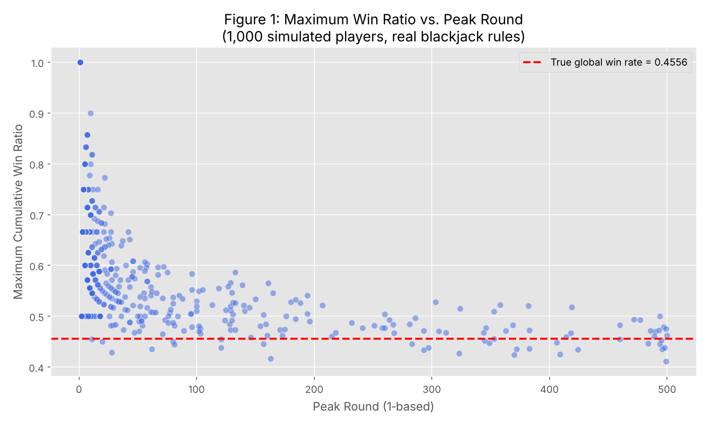
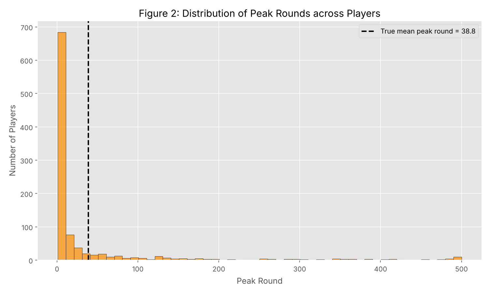

<h1 align="center">Blackjack Win-Ratio Simulation</h1>
<p align="center"><i>When does a typical player hit their peak, and how high does it go before the house edge takes over?</i></p>
<p align="center">  </p>

## At a glance
| | |
|---|---|
| **Simulator** | 6-deck shoe, cards drawn without replacement, dealer stands on 17, pushes excluded |
| **Population** | 1,000 players x 500 decisive rounds each |
| **Sampling** | Systematic sample of 100 players (every 10th, random start) |
| **Uncertainty** | 95% CIs from 1,000 bootstrap resamples |
| **Overall win rate** | 45.6%, the house edge under these rules |

## The question
Players often win early and then drift back toward the house edge. At what round does a typical player's cumulative win ratio peak, and how high is it?

## Results
| Quantity | True (N = 1,000) | Sample estimate | 95% bootstrap CI |
|---|---|---|---|
| Mean peak round | 38.78 | 45.70 | [21.85, 69.55] |
| Mean max win ratio | 0.7658 | 0.7677 | [0.7229, 0.8126] |

Both intervals capture the true values. Peak rounds are heavily right-skewed: most players peak within the first few dozen rounds and then regress toward 45.6%.

<p align="center">
 
</p>

## Why bootstrap
Early-round win ratios are discrete fractions (1/2, 2/3, 3/4) and peak rounds are skewed, so normal-theory variance formulas fit poorly. Resampling the sample directly avoids that assumption.

## Run it
```
pip install -r requirements.txt
python blackjack_simulation.py
```
Takes under a minute. Seeded (42) so results reproduce.
